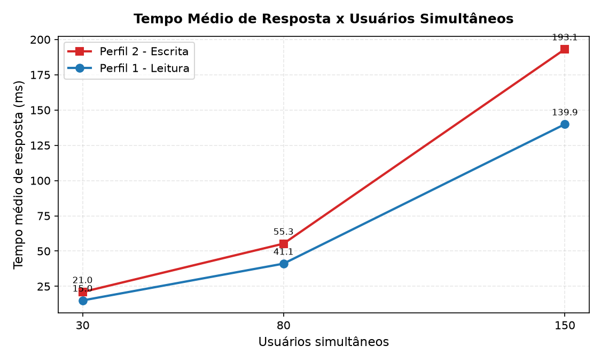
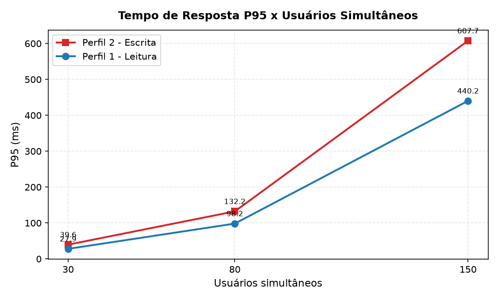
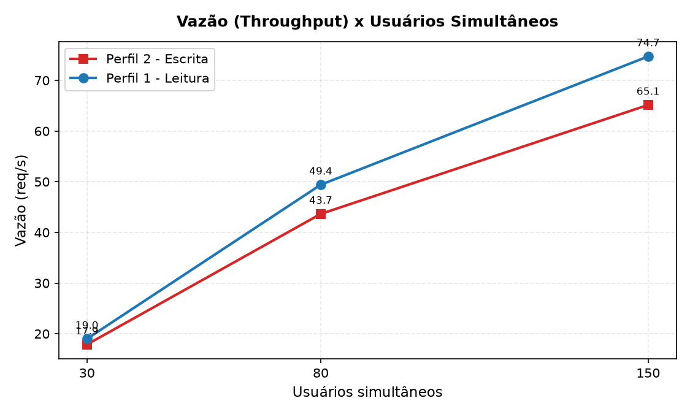
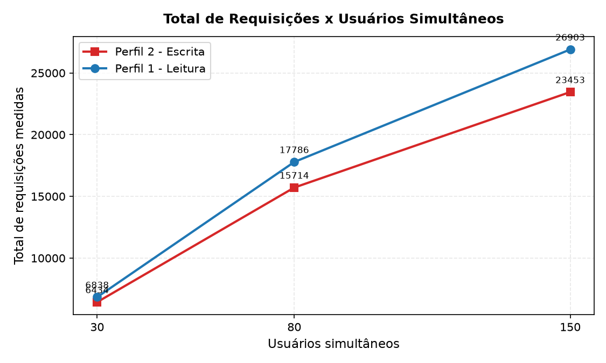
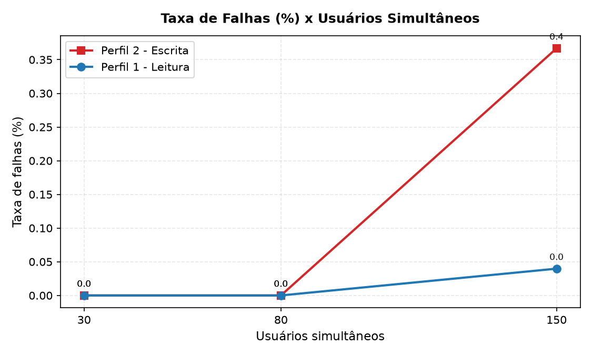
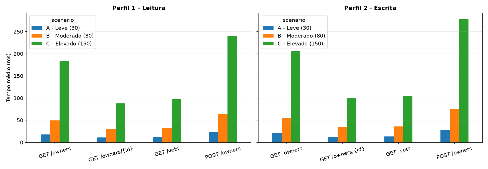
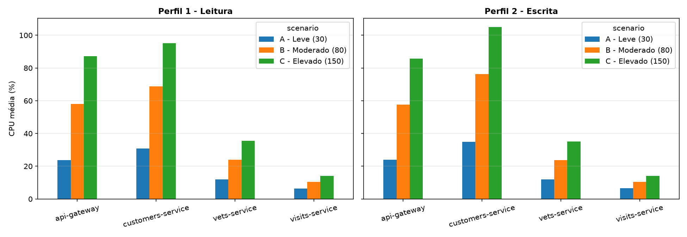

# TP06 – Avaliação de Desempenho de Microsserviços com Locust

**Aluna:** Kaylanne Oliveira de Sousa (GitHub: itskaydev)   
**Curso:** Sistemas de Informação – UFPI (CSHNB)  
**Aplicação:** [Spring PetClinic Microservices](https://github.com/spring-petclinic/spring-petclinic-microservices) · **Ferramenta de carga:** Locust

> 🎥 **Vídeo demonstrativo:** `<https://youtu.be/YptK5uGqY9o?is=RjHA3-0_FmTIZj-M>`

---

## 1. Objetivo
Avaliar o desempenho do Spring PetClinic Microservices utilizando o Locust, analisando o impacto da quantidade de usuários concorrentes (30, 80 e 150) e de dois perfis distintos de utilização (leitura e escrita).

## 2. Descrição do Ambiente
| Item | Descrição / Valor |
|---|---|
| **Máquina do Host** | Notebook Intel Core i3-1115G4 (11ª ger.) 3,00 GHz, 8 GB RAM (7,73 GB utilizáveis) |
| **Sistema Operacional** | Windows 11 Home Single Language 64 bits |
| **Orquestração** | Docker Compose (Docker Desktop + WSL2 backend), imagens `springcommunity/*` do Docker Hub |
| **Versão da Aplicação** | Repositório oficial `spring-petclinic-microservices` (branch `main`) |
| **Serviços Ativos** | `config-server`, `discovery-server`, `customers-service`, `vets-service`, `visits-service`, `api-gateway` (limite de 512 MB de memória cada) |
| **Serviços Desligados** | `genai-service`, `admin-server`, `tracing-server`, `grafana`, `prometheus` (desativados para economia de RAM) |
| **Banco de Dados** | HSQLDB em memória (padrão da aplicação, inicializado com 10 donos via `data.sql`) |
| **Python / Locust** | Python 3.12 / Locust 2.47 |

### Mapeamento dos Endpoints (via API Gateway na porta 8080)
Todas as requisições passam pelo API Gateway (porta 8080), que aplica o filtro `StripPrefix=2` e encaminha para o respectivo microsserviço:

| Operação do Enunciado | URL Chamada no Gateway | Microsserviço Destino | Método / Payload |
|---|---|---|---|
| **GET /owners** | `GET /api/customer/owners` | customers-service | Recupera todos os proprietários cadastrados |
| **GET /owners/{id}** | `GET /api/customer/owners/{id}` | customers-service | Recupera detalhes de um dono específico (IDs de 1 a 10) |
| **GET /vets** | `GET /api/vet/vets` | vets-service | Recupera a lista de veterinários |
| **POST /owners** | `POST /api/customer/owners` | customers-service | Cria um novo proprietário (JSON com `firstName`, `lastName`, `address`, `city`, `telephone`) |

---

## 3. Instruções de Reprodução

### 1. Subir a aplicação PetClinic
No terminal:
```bash
git clone https://github.com/spring-petclinic/spring-petclinic-microservices.git
cd spring-petclinic-microservices
docker compose up -d config-server discovery-server customers-service vets-service visits-service api-gateway
```
Aguarde cerca de 2 minutos para os serviços inicializarem e confira no Eureka em `http://localhost:8761`.

### 2. Configurar o ambiente do Locust
Na pasta deste projeto:
```bash
python -m venv .venv
.venv\Scripts\activate
pip install -r requirements.txt
```

### 3. Executar os experimentos
```bash
python run_experiments.py --reps 10
```
Para um teste rápido de validação do ambiente (1 repetição de 30s):
```bash
python run_experiments.py --reps 1 --scenarios A --warmup 10 --duration 30
```
O script salva o progresso a cada repetição finalizada, podendo ser pausado com `Ctrl+C` e retomado depois.

### 4. Gerar tabelas e gráficos
```bash
python analyze.py
```
O script processa os dados de `results/raw/`, calcula as médias descartando o aquecimento e atualiza os arquivos em `results/`.

---

## 4. Metodologia

- **Perfis de Carga:**
  - **Perfil 1 — Leitura:** 45% `GET /owners`, 35% `GET /owners/{id}`, 15% `GET /vets`, 5% `POST /owners`.
  - **Perfil 2 — Escrita:** 20% `GET /owners`, 20% `GET /owners/{id}`, 20% `GET /vets`, 40% `POST /owners`.
  - Implementados via pesos na anotação `@task` do Locust nas classes `ReadProfile` e `WriteProfile`.
- **Cenários Experimentais:**
  - **Cenário A — Leve:** 30 usuários simultâneos.
  - **Cenário B — Moderado:** 80 usuários simultâneos.
  - **Cenário C — Elevado:** 150 usuários simultâneos.
- **Duração e Aquecimento:** Cada teste dura 7 minutos (1 min de aquecimento + 6 min de medição). O aquecimento é descartado via `environment.stats.reset_all()` no Locust aos 60s, e as amostras de CPU são filtradas para `t >= 60s`.
- **Tempo de Espera (Think Time):** `between(1, 2)` segundos entre requisições consecutivas de cada usuário.
- **Isolamento entre Execuções:** Antes de cada execução o container do `customers-service` é reiniciado, garantindo que o banco HSQLDB em memória retorne aos 10 donos iniciais e evitando acúmulo de dados entre repetições.
- **Métricas Coletadas:**
  1. Tempo médio de resposta (ms)
  2. Tempo de resposta P95 (ms)
  3. Vazão (req/s)
  4. Total de requisições
  5. Taxa de falhas (%)
  6. Utilização de CPU e memória dos serviços (`api-gateway`, `customers-service`, `vets-service`, `visits-service`)

---

## 5. Resultados

### 5.1. Resumo Geral Consolidado (Média de 10 Repetições)

| Cenário | Perfil | Repetições | Tempo Médio (ms) | Desvio Padrão (ms) | P95 (ms) | Vazão (req/s) | Total Requisições | Falhas (%) |
| --- | --- | --- | --- | --- | --- | --- | --- | --- |
| A (30 u) | Perfil 2 (Escrita) | 10 | 20.97 | 0.50 | 39.60 | 17.87 | 6434.50 | 0.00 |
| A (30 u) | Perfil 1 (Leitura) | 10 | 15.03 | 0.38 | 27.90 | 19.00 | 6838.30 | 0.00 |
| B (80 u) | Perfil 2 (Escrita) | 10 | 55.28 | 1.42 | 132.20 | 43.65 | 15714.60 | 0.00 |
| B (80 u) | Perfil 1 (Leitura) | 10 | 41.11 | 0.85 | 98.20 | 49.41 | 17786.90 | 0.00 |
| C (150 u) | Perfil 2 (Escrita) | 10 | 193.11 | 5.92 | 607.70 | 65.15 | 23453.30 | 0.37 |
| C (150 u) | Perfil 1 (Leitura) | 10 | 139.92 | 3.93 | 440.20 | 74.73 | 26903.00 | 0.04 |


### 5.2. Desempenho e Distribuição por Operação

| Cenário | Perfil | Operação | Requisições | Tempo Médio (ms) | P95 (ms) | Falhas (%) | Distribuição (%) |
| --- | --- | --- | --- | --- | --- | --- | --- |
| A (30 u) | Perfil 2 (Escrita) | POST /owners | 2574.10 | 28.64 | 52.60 | 0.00 | 40.00 |
| A (30 u) | Perfil 2 (Escrita) | GET /owners | 1286.80 | 21.20 | 38.60 | 0.00 | 20.00 |
| A (30 u) | Perfil 2 (Escrita) | GET /owners/{id} | 1286.80 | 12.93 | 23.40 | 0.00 | 20.00 |
| A (30 u) | Perfil 2 (Escrita) | GET /vets | 1286.80 | 13.45 | 24.30 | 0.00 | 20.00 |
| A (30 u) | Perfil 1 (Leitura) | GET /owners | 3077.60 | 18.09 | 32.80 | 0.00 | 45.00 |
| A (30 u) | Perfil 1 (Leitura) | GET /owners/{id} | 2393.70 | 11.00 | 19.90 | 0.00 | 35.00 |
| A (30 u) | Perfil 1 (Leitura) | GET /vets | 1025.50 | 12.29 | 22.10 | 0.00 | 15.00 |
| A (30 u) | Perfil 1 (Leitura) | POST /owners | 341.50 | 23.87 | 43.60 | 0.00 | 5.00 |
| B (80 u) | Perfil 2 (Escrita) | POST /owners | 6286.20 | 75.36 | 176.60 | 0.00 | 40.00 |
| B (80 u) | Perfil 2 (Escrita) | GET /owners | 3142.80 | 55.40 | 129.70 | 0.00 | 20.00 |
| B (80 u) | Perfil 2 (Escrita) | GET /owners/{id} | 3142.80 | 34.35 | 80.20 | 0.00 | 20.00 |
| B (80 u) | Perfil 2 (Escrita) | GET /vets | 3142.80 | 35.95 | 84.00 | 0.00 | 20.00 |
| B (80 u) | Perfil 1 (Leitura) | GET /owners | 8004.40 | 49.72 | 116.30 | 0.00 | 45.00 |
| B (80 u) | Perfil 1 (Leitura) | GET /owners/{id} | 6225.70 | 30.16 | 70.20 | 0.00 | 35.00 |
| B (80 u) | Perfil 1 (Leitura) | GET /vets | 2667.90 | 33.16 | 77.50 | 0.00 | 15.00 |
| B (80 u) | Perfil 1 (Leitura) | POST /owners | 888.90 | 64.11 | 150.10 | 0.00 | 5.00 |
| C (150 u) | Perfil 2 (Escrita) | POST /owners | 9381.50 | 277.70 | 860.30 | 0.50 | 40.00 |
| C (150 u) | Perfil 2 (Escrita) | GET /owners | 4690.60 | 205.14 | 635.50 | 0.28 | 20.00 |
| C (150 u) | Perfil 2 (Escrita) | GET /owners/{id} | 4690.60 | 100.09 | 309.80 | 0.28 | 20.00 |
| C (150 u) | Perfil 2 (Escrita) | GET /vets | 4690.60 | 104.91 | 324.90 | 0.28 | 20.00 |
| C (150 u) | Perfil 1 (Leitura) | GET /owners | 12106.80 | 183.22 | 567.60 | 0.04 | 45.00 |
| C (150 u) | Perfil 1 (Leitura) | GET /owners/{id} | 9416.30 | 87.88 | 272.00 | 0.04 | 35.00 |
| C (150 u) | Perfil 1 (Leitura) | GET /vets | 4035.30 | 98.45 | 304.60 | 0.03 | 15.00 |
| C (150 u) | Perfil 1 (Leitura) | POST /owners | 1344.60 | 239.03 | 740.50 | 0.00 | 5.00 |


### 5.3. Utilização de CPU e Memória por Serviço (docker stats)

| Cenário | Perfil | Serviço | CPU Média (%) | CPU Pico (%) | Memória Média (MB) |
| --- | --- | --- | --- | --- | --- |
| A (30 u) | Perfil 2 (Escrita) | api-gateway | 24.03 | 25.98 | 342.63 |
| A (30 u) | Perfil 2 (Escrita) | customers-service | 34.87 | 37.58 | 397.81 |
| A (30 u) | Perfil 2 (Escrita) | vets-service | 12.04 | 12.97 | 312.06 |
| A (30 u) | Perfil 2 (Escrita) | visits-service | 6.53 | 7.03 | 292.81 |
| A (30 u) | Perfil 1 (Leitura) | api-gateway | 23.66 | 25.59 | 342.35 |
| A (30 u) | Perfil 1 (Leitura) | customers-service | 30.75 | 33.10 | 397.46 |
| A (30 u) | Perfil 1 (Leitura) | vets-service | 11.88 | 12.81 | 312.42 |
| A (30 u) | Perfil 1 (Leitura) | visits-service | 6.45 | 6.94 | 292.04 |
| B (80 u) | Perfil 2 (Escrita) | api-gateway | 57.66 | 61.91 | 367.48 |
| B (80 u) | Perfil 2 (Escrita) | customers-service | 76.35 | 82.51 | 422.28 |
| B (80 u) | Perfil 2 (Escrita) | vets-service | 23.71 | 25.62 | 327.67 |
| B (80 u) | Perfil 2 (Escrita) | visits-service | 10.38 | 11.20 | 297.64 |
| B (80 u) | Perfil 1 (Leitura) | api-gateway | 57.96 | 62.42 | 367.60 |
| B (80 u) | Perfil 1 (Leitura) | customers-service | 68.78 | 74.19 | 422.28 |
| B (80 u) | Perfil 1 (Leitura) | vets-service | 23.87 | 25.81 | 327.60 |
| B (80 u) | Perfil 1 (Leitura) | visits-service | 10.50 | 11.30 | 297.40 |
| C (150 u) | Perfil 2 (Escrita) | api-gateway | 85.72 | 92.61 | 397.52 |
| C (150 u) | Perfil 2 (Escrita) | customers-service | 105.04 | 113.39 | 457.69 |
| C (150 u) | Perfil 2 (Escrita) | vets-service | 35.07 | 37.69 | 342.51 |
| C (150 u) | Perfil 2 (Escrita) | visits-service | 14.01 | 15.07 | 308.16 |
| C (150 u) | Perfil 1 (Leitura) | api-gateway | 87.25 | 93.94 | 397.35 |
| C (150 u) | Perfil 1 (Leitura) | customers-service | 95.16 | 102.63 | 457.66 |
| C (150 u) | Perfil 1 (Leitura) | vets-service | 35.51 | 38.22 | 342.70 |
| C (150 u) | Perfil 1 (Leitura) | visits-service | 14.18 | 15.28 | 307.23 |

### 5.4. Gráficos Comparativos Gerados














---

## 6. Respostas às Questões

### 6.1. Como o aumento de usuários afeta o tempo de resposta?
O aumento da quantidade de usuários simultâneos de 30 para 80 e 150 provocou um crescimento não-linear no tempo de resposta:
- No **Perfil 1 (Leitura)**, o tempo médio foi de **15,03 ms** no cenário A para **41,11 ms** no cenário B e alcançou **139,92 ms** no cenário C (um aumento de 9,31 vezes). O percentil 95 (P95) subiu de **27,90 ms** para **440,20 ms**.
- No **Perfil 2 (Escrita)**, a média subiu de **20,97 ms** no cenário A para **55,28 ms** no cenário B e chegou a **193,11 ms** no cenário C (aumento de 9,21 vezes). O P95 foi de **39,60 ms** para **607,70 ms**.

Sob carga leve (30 usuários), o tempo de processamento é quase instantâneo. Com 80 e 150 usuários, o tempo de enfileiramento nas threads do gateway e dos serviços passa a predominar, elevando significativamente a latência na cauda (P95).

### 6.2. Qual perfil apresenta maior vazão?
O **Perfil 1 — Leitura** obteve maior vazão média em todos os cenários:
- **Cenário A (30 usuários):** Leitura = **19,00 req/s** vs. Escrita = **17,87 req/s**
- **Cenário B (80 usuários):** Leitura = **49,41 req/s** vs. Escrita = **43,65 req/s**
- **Cenário C (150 usuários):** Leitura = **74,73 req/s** vs. Escrita = **65,15 req/s**

Na média geral, o Perfil 1 sustentou **47,71 req/s** contra **42,22 req/s** do Perfil 2. Isso ocorre porque consultas simples de leitura não envolvem o overhead de validação de dados nem escrita transacional no banco de dados, liberando as conexões mais rapidamente.

### 6.3. Quais operações apresentam maior degradação?
Comparando o tempo médio no cenário C (150 usuários) em relação ao cenário A (30 usuários), as operações que mais degradaram foram:
1. **GET /owners:** Aumento de **10,13x** na Leitura (18,09 ms para 183,22 ms) e **9,68x** na Escrita (21,20 ms para 205,14 ms). Por retornar a listagem completa de donos cadastrados, ela trafega e serializa uma carga de dados maior.
2. **POST /owners:** Aumento de **9,70x** na Escrita (28,64 ms para 277,70 ms) e **10,01x** na Leitura (23,87 ms para 239,03 ms), devido ao custo adicional de validação e persistência no banco.
3. **GET /vets:** Degradação de **8,01x** na Leitura e **7,80x** na Escrita.
4. **GET /owners/{id}:** Apresentou a menor degradação (**7,99x** na Leitura e **7,74x** na Escrita), por ser uma busca pontual e indexada por ID.

### 6.4. Como o consumo de CPU varia entre os cenários?
O consumo de CPU aumentou progressivamente com a carga em todos os serviços:
- **customers-service:** Foi o serviço mais exigido, variando de **30,7%** (cenário A) para **68,8%** (cenário B) e atingindo **95,2%** na Leitura e **105,0%** (com pico de 113,4%) na Escrita no cenário C. Ele concentra cerca de 80% a 85% de todas as requisições geradas.
- **api-gateway:** O segundo mais exigido, subindo de **23,7%** (A) para **58,0%** (B) e atingindo **87,3%** (C), pois roteia todo o tráfego de entrada.
- **vets-service:** Teve uso moderado, acompanhando os 15% a 20% das requisições direcionadas a ele: **11,9%** (A), **23,9%** (B) e **35,5%** (C).
- **visits-service:** Manteve baixo consumo de CPU (**6,4%** a **14,2%**), por não ser alvo direto das operações dos perfis avaliados.

### 6.5. Qual cenário apresenta maior taxa de falhas?
O cenário com maior taxa de falhas foi o **Cenário C (150 usuários) no Perfil 2 — Escrita**, registrando **0,37% de falhas** (com o endpoint `POST /owners` atingindo 0,50%). O Cenário C no Perfil 1 registrou apenas **0,04% de falhas**. Nos cenários A (30 usuários) e B (80 usuários), a taxa de falhas foi de **0,00%** em ambos os perfis.

As falhas no cenário mais concorrido decorrem da saturação de CPU do `customers-service` no ambiente de teste, gerando esgotamento pontual do pool de conexões e timeouts de requisição.

---

## 7. Conclusões
1. **Gargalo Principal:** O ponto crítico da arquitetura foi o **`customers-service`**, seguido pelo **`api-gateway`**. Por responder pela grande maioria das rotas do PetClinic, o customers-service atinge o teto de processamento sob alta concorrência. Em um ambiente de produção, seria o primeiro serviço a demandar réplicas adicionais e balanceamento de carga horizontal.
2. **Capacidade do Ambiente:** A aplicação operou de forma estável até **80 usuários simultâneos**, com zero falhas e tempos médios abaixo de 60 ms. Com 150 usuários, o sistema entra em regime de saturação, elevando o P95 acima de 600 ms.
3. **Perfil de Carga:** O perfil de escrita impõe um custo computacional sensivelmente maior do que o de leitura, resultando em tempos de resposta aproximadamente 38% maiores e uma vazão entre 13% e 15% menor.

---

## 8. Limitações do Ambiente
- **Hardware Compartilhado:** Todos os 6 microsserviços e o cliente do Locust rodaram na mesma máquina física (Intel Core i3 com 2 núcleos / 4 threads e 8 GB de RAM), disputando os mesmos recursos de processamento e memória.
- **Banco em Memória:** Foi utilizado o HSQLDB em memória padrão da aplicação, o que reduz a latência de disco que existiria em um banco relacional externo em produção.
